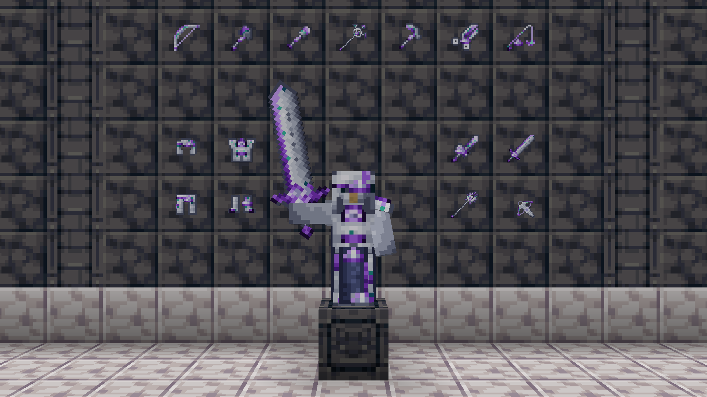
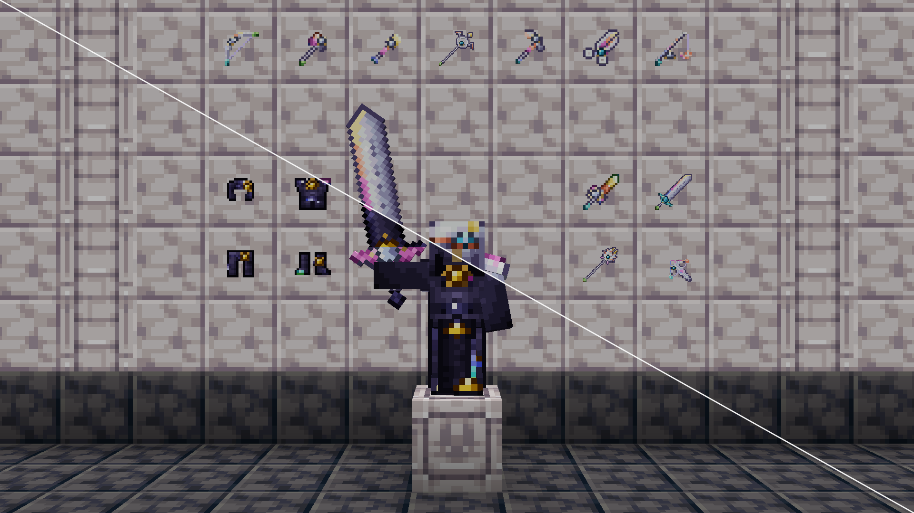

# Spectral Ascension

Four new tiers of Spectrum equipment for the late game of All the Mods 10.

Spectral Ascension is an unofficial addon for [Spectrum](https://github.com/DaFuqs/Spectrum), made for the **All the Mods 10** modpack. In Spectrum, bedrock gear is where the road ends; in ATM10, that point comes long before the game is over. This addon continues the climb with four tiers, **Trichromatic**, **Umbral**, **Argent** and **Prismatic**, each one tied to the metals of Allthemodium and built on the tools, weapons and armor you already know from Spectrum.

## Showcase

| Trichromatic | Umbral |
|---|---|
|  |  |
| **Argent** | **Prismatic** |
|  |  |

*Prismatic gear is animated: its image shows the two phases of the animation, split along the diagonal.*

## Four tiers, one climb

Each tier has 15 pieces: a full set of tools, Spectrum's special weapons and a full suit of armor. Every tier is built from the gear of the tier below, and the first one starts from Spectrum's own endgame equipment, so your gear grows with you instead of being replaced.

- **Trichromatic** opens the path once you reach Spectrum's late game and start working with Allthemodium.
- **Umbral** follows with vibranium.
- **Argent** follows with unobtainium.
- **Prismatic** crowns the climb with Allthemodium's alloys.

Each tier mines like the Allthemodium tools of its metal, hits harder than the one before, and comes pre-enchanted with stronger signature enchantments. Everything is unbreakable and fireproof, like Spectrum's bedrock gear, and every item and armor piece is animated.

## What is in a tier

- **Tools:** workstaff (the pickaxe of each tier), axe, shovel, hoe and shears.
- **Weapons:** sword, bow, ultra greatsword, crossbow and bident.
- **Utility:** a fishing rod that, like Spectrum's bedrock rod, can fish in lava.
- **Armor:** helmet, chestplate, leggings and boots.

The special weapons keep everything that makes their Spectrum counterparts unique: the ultra greatsword keeps its ground slam and gains more reach with every tier, the crossbow keeps its overcharge, and the bow keeps its zoom and precision.

## Armor and Azure Dike

Wearing a full set of four pieces, from any mix of tiers, grants the Azure Dike of Spectrum's whole line of Dike accessories at once. While the set is worn, Dike accessories in your trinket slots stop counting, so those slots are free for something else.

## Enchantments and the ATM10 caps

Spectral Ascension aligns Spectrum's enchanting with the enchantment caps of ATM10:

- the Enchanter never copies a vanilla enchantment above the ATM10 cap, from any book or item;
- overenchanting at the Enchanter unlocks with an advancement, earned by finding an enchanted book or item above the vanilla maximum (Spectral Ascension's own gear does not count);
- upgrading from one tier to the next keeps your enchantments, and when both pieces share one the higher level wins;
- neither the vanilla anvil nor Spectrum's Bedrock Anvil lowers the enchantments already on our gear;
- books extracted from our gear with Apothic Enchanting's tools come out within the ATM10 caps.

## World changes

- **Shooting stars:** Colorful shooting stars fall more often. How many stars fall is unchanged.
- **Mining Dimension:** shimmerstone, azurite, stratine and paltaeria ores generate in Allthemodium's Mining Dimension.

## Learn in game

Spectral Ascension adds its own chapters to Spectrum's guidebook, written as journal entries like the rest of the book, and an Idea that hints at the first step. Each tier, its guidebook chapter and its recipes unlock with an advancement as you progress, and recipe viewers show them as locked until then. Controls and switches are explained in the item tooltips. All items, already enchanted, appear in the Equipment section of Spectrum's creative tab.

## Download

Get the latest version on [CurseForge](https://www.curseforge.com/minecraft/mc-mods/spectral-ascension).

Every version is also published as a release, with the jar attached, on [Forgejo](https://git.artysan.me/cromocon/spectral-ascension/releases) and [GitHub](https://github.com/Cromocon/spectral-ascension/releases).

## Requirements

Install on both client and server.

Tested setup:

- Minecraft 1.21.1
- NeoForge 21.1.265
- Spectrum 1.12.9
- Revelationary 1.5.2
- Allthemodium 3.2.1
- Java 21

Spectrum and Allthemodium are required and must be installed separately, together with their own dependencies. **Spectrum is not part of ATM10**: add Spectrum and Revelationary to the pack yourself. Allthemodium, Modonomicon, Curios and GeckoLib are already included in ATM10.

The addon also works with Apothic Enchanting, which is part of ATM10. To see Spectrum's recipes in JEI, add SpectrumJEI as well (optional, not part of ATM10).

This release targets NeoForge, not Forge or Fabric.

Spectral Ascension is an unofficial addon. It is not affiliated with or endorsed by DaFuqs or the Spectrum team.

Known limitations:

- Balance is still being tuned, and some values may change between versions.
- The ATM10 enchantment caps are a fixed table matching ATM10's defaults; they do not follow changes to Apothic Enchanting's configuration.
- On a dedicated server, the tooltips of the ultra greatsword and crossbow can fail if another mod asks for them on the server side. The error comes from inside Spectrum and affects Spectrum's own glass crest items too.

## License

LGPL-3.0-only

## Source code and issues

- Source code: https://git.artysan.me/cromocon/spectral-ascension (main repository)
- Mirror: https://github.com/Cromocon/spectral-ascension
- Bug reports and suggestions: https://github.com/Cromocon/spectral-ascension/issues
