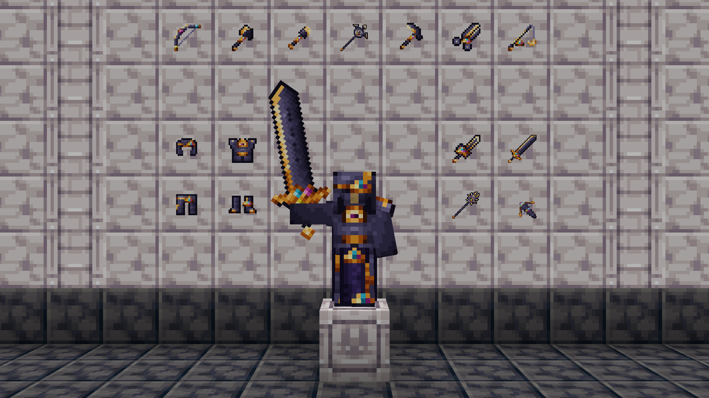
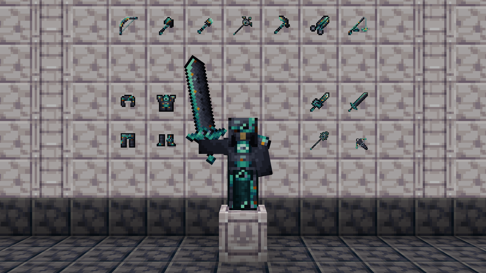

# Spectral Ascension

Unofficial addon for [Spectrum](https://github.com/DaFuqs/Spectrum), made for the **All the Mods 10** modpack.
It adds four tiers of Spectrum equipment for the ATM10 late game: **Trichromatic**, **Umbral**, **Argent** and **Prismatic**.

## Showcase

| Trichromatic | Umbral |
|---|---|
|  |  |
| **Argent** | **Prismatic** |
|  |  |

## Requirements
- Minecraft 1.21.1, NeoForge
- Spectrum 1.12.9
- Allthemodium

## Download
Get the jar from the [Releases](../../releases) page.

## License
LGPL-3.0-only
